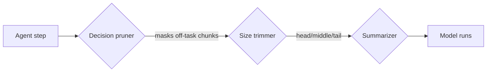

# dsh-compaction-decision-pruner

**Extractive context pruning for [DeepSeek Harness](https://github.com/deepseek-ai/deepseek-harness) compaction, driven by a decision model instead of a generative summary.**

A dsh plugin that scores each tool result against the session's active goal with a
typed `noul` question, and replaces the chunks that no longer matter with an
opaque marker. Surviving text is never rewritten, so file paths, error codes, and
line numbers keep exact fidelity.

```
[.. pruned 812 tok | read seq 20 | off-task, full text in session log ..]
```

Works with any server that speaks the **Jev / SystemOne** decision API — for
example [Cloudflare Clef](https://huggingface.co/Cloudflare/clef-flash) served by
SGLang or any OpenAI-compatible local runtime.

## Why not just summarize?

The shipped `dsh-compaction-basic` backend relieves context pressure by asking a
chat model to *rewrite* older history into a summary. That costs a full
generation, and a rewrite can mangle exactly the details an agent needs back.

| | Generative summary | This plugin |
|---|---|---|
| Output | New prose about the old text | The old text, minus what is not needed |
| Fidelity | Paths, codes, and line numbers can drift | Retained text is byte-identical |
| Cost | One generation per compaction | One forward pass, no generated tokens |
| Latency | Seconds to tens of seconds | ~2 s for a small batch on CPU |
| Failure mode | A plausible but wrong detail | Nothing removed, or a marker added |
| Recoverable | Original stays in the log | Original stays in the log |

It is not a replacement for summarization — it is the **cheapest first pass**. It
runs before the backend measures pressure, so a successful mask often leaves the
surface below threshold and no summary happens at all.

## Where it sits



1. **Decision pruner** (this plugin) — extractive, no model generation.
2. **Size trimmer** (`@deepseek-ai/dsh-compaction-tool-result-pruner`) — model-free
   head/middle/tail trimming of anything oversized.
3. **Summarizer** (`@deepseek-ai/dsh-compaction-basic`) — the expensive generative
   path.

## How it works

1. **Chunks at natural boundaries.** One chunk per `tool/result` surface node —
   never a token-count slice, so a chunk is always a coherent unit.
2. **Scores every chunk against the goal** with one batched request. All chunks in
   a batch are answered in a single forward pass with no generated text.
3. **Masks what falls below `keepThreshold`.** The chunk's text is replaced by the
   marker; the chunk's event stays in history, so the agent still knows a step
   happened. Chunks at or above the threshold are left untouched.

Each masked chunk appends two events: a `compaction/prune` shadow-price record
pricing what was removed, then a replacement `tool/result` that cites the original
seq. The full original remains in the append-only session log, so replay
reproduces exactly what produced the marker.

## Install

```bash
npm install dsh-compaction-decision-pruner
# or, from a clone
npm run build
```

Compose it next to the backend it feeds:

```yaml
- name: '@deepseek-ai/dsh-compaction-basic'
- name: '@deepseek-ai/dsh-compaction-tool-result-pruner'
- name: 'dsh-compaction-decision-pruner'
```

A ready-to-merge row is in [`cordis.patch.yml`](./cordis.patch.yml). The loader
also accepts an absolute path to `lib/index.js`, so a profile can point straight
at a checkout with no install step.

## Configuration

Every option is declared as a schema, so the row is configurable from your DSH
client as well as from a patch file. `baseUrl` is the only one with no
usable default; everything else falls back to the values below.

```ts
import { Config } from 'dsh-compaction-decision-pruner'
```

Because the schema is declared, the harness validates a row's config before the
plugin starts, and its config editor validates edits against the same schema. A
bad value fails the row with a diagnostic naming the field and the constraint,
for example:

```text
$ .keepThreshold expected number <= 1 but got 5 (at keepThreshold)
```

rather than silently misconfiguring the pruner. The plugin also validates its own
input, rejecting unknown keys with a readable message and requiring `baseUrl` and
a `{k}` placeholder in `question`.

| Key | Default | Meaning |
|---|---|---|
| `baseUrl` | `DECISION_BASE_URL` env, else required | Decision-model server. |
| `model` | `clef-flash` | Decision model id. |
| `apiKeyEnv` | `OPENAI_COMPAT_API_KEY` | Env var holding the bearer token. |
| `apiKey` | `""` | Literal token; overrides `apiKeyEnv`. |
| `keepThreshold` | `0.35` | Mask when P(information lost) is below this. |
| `question` | counterfactual wording (below) | `noul` question; must contain `{k}`. |
| `minChars` | `480` | Never score chunks smaller than this. |
| `minTokensToScore` | `40000` | Never score until the surface is this large. |
| `protectTail` | `6` | Trailing surface nodes that are never touched. |
| `maxChunks` | `24` | Chunks per scoring request. |
| `maxRequests` | `2` | Scoring requests per compaction pass. |
| `scoreChars` | `2000` | Per-chunk character window sent for scoring. |
| `maxStateChars` | `48000` | Whole-request state budget. |
| `timeoutMs` | `30000` | Per-request timeout. |
| `failureBackoffMs` | `300000` | Stop scoring for this long after a failure. |
| `dryRun` | `false` | Score and log without rewriting the surface. |
| `traceFile` | `""` | Append one NDJSON line per scored chunk, for tuning. |
| `enabled` | `true` | Arm the pruner. |

`minTokensToScore` is compared against the token meter's measurement of the whole
request envelope (system prompt, tool definitions, and surface), not just the
conversation, so pick it from an observed value rather than guessing.

### Choosing the question

The wording decides precision, far more than the threshold does. Measured against
a task that needed one file and not another:

| Question | Needed | Filler | Usable? |
|---|---|---|---|
| `Is chunk {k} necessary to achieve the goal?` | 0.13 | 0.01 | no — both collapse low |
| `Does chunk {k} contain information needed to complete the goal?` | 0.10 | 0.01 | no |
| `Is chunk {k} useful, non-redundant evidence for the goal?` | 0.12 | 0.01 | no |
| **`If chunk {k} were removed, would information required for the goal be lost?`** | **0.95** | **0.04** | **yes** |

The counterfactual phrasing is the default because it is the only one of the four
that separates real evidence from filler — and it is also the safest semantics,
since it prunes only what is genuinely expendable.

Truncating chunk text too aggressively destroys the signal for the same reason:
a whole-file chunk cut at 700 characters lost the tail it was needed for and
scored 0.15 instead of 0.95. Keep `scoreChars` above the payload you care about.

## Decision API

```
POST {baseUrl}/v1/systemone
{ "model": "clef-flash",
  "state": { "goal": "…", "chunks": { "c0": "…" } },
  "questions": { "c0": { "type": "noul", "instructions": "…" } } }

→ { "answers": { "c0": { "type": "noul", "noul": 0.04 } }, "usage": { … } }
```

- `noul` answers P(true) — the shape this plugin uses.
- `choice` and `score` are also part of the API, but not needed here.
- The input is capped (16 384 tokens by default); the state is truncated first and
  the schema is never truncated, so keep `maxStateChars` and `scoreChars` in mind.

## Safety

- **Fails open.** Any scoring or replacement error is logged and compaction
  proceeds unmasked; the compaction result is still returned.
- **Backs off.** After a failure, scoring pauses for `failureBackoffMs`, so an
  unreachable server costs one timeout rather than one per turn.
- **Cheap when idle.** Nothing runs below `minTokensToScore`.
- **Protected recent history.** The last `protectTail` surface nodes and every
  chunk below `minChars` are never candidates.
- **Idempotent.** An already-masked chunk is skipped, so markers never nest.
- **Bounded.** At most `maxRequests × maxChunks` chunks are scored per pass.

## Testing

```bash
npm test        # 34 tests, no model or server needed
npm run check   # typecheck src and test
npm run build   # emit lib/
```

The suite drives the plugin through its public surface with fake cordis, session,
and `fetch` objects that mirror the shapes dsh writes. Several tests are direct
regressions for real defects: the `startSeq`/`endSeq` rename between dsh
`0.1.2-rc.1` and `0.2.0-rc.2`, `protectTail: 0` selecting the entire surface
(`slice(-0)`), injected `user/message` reminders being mistaken for the goal, and
a missing guard that let `apply()` throw when no compaction backend was composed.

## Operational notes

- **Patches are read at boot.** The harness loads its plugin tree when it starts,
  so editing a patch file has no effect until the owning process restarts. If the
  harness is a long-lived singleton, restart it rather than reloading.
- **Confirm it armed.** Set `traceFile`: the first line is
  `{"event":"armed","model":…,…}`, followed by one line per scored chunk. A row
  that fails to load leaves no trace at all, and a harness's own stderr is not
  always surfaced, so this is the reliable check.
- **The model must be servable when scoring happens.** If the decision model is
  not loaded, requests fail and the plugin backs off; the session still works, it
  just stops pruning.

## Compatibility

| | Version |
|---|---|
| dsh | `0.2.0-rc.2` (verified) |
| Node | `>=22.19` |
| Runtime dependencies | one host-provided peer, `@deepseek-ai/schemastery`, which dsh already ships; every other `@deepseek-ai/*` import is type-only, so the built output pulls in nothing else |

The plugin subclasses nothing and consumes no harness package at runtime beyond
the config schema: it wraps the composed `ctx.compaction.compactIfNeeded`, which
the shipped `dsh-compaction-basic` documents as dynamically dispatched.

dsh is a developer preview that promises breaking changes, so pin exact versions
and re-run `npm test` after an upgrade — the suite is written to catch contract
drift.

## License

MIT
